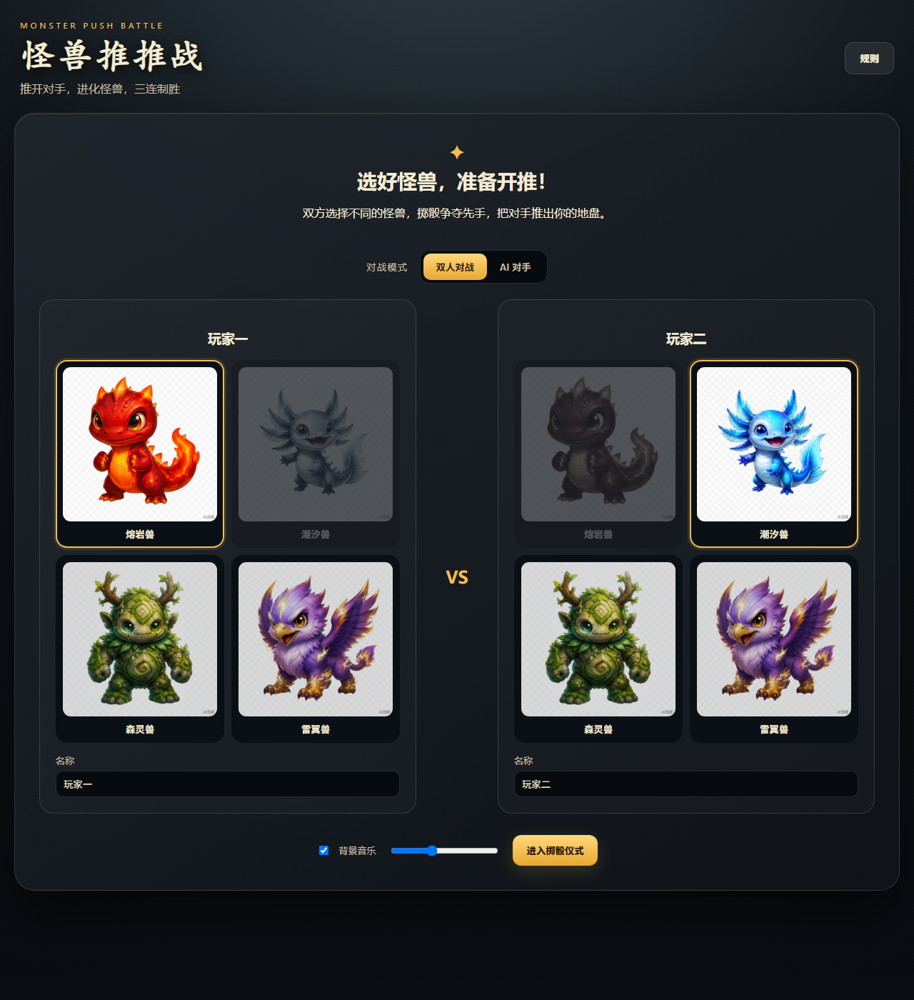
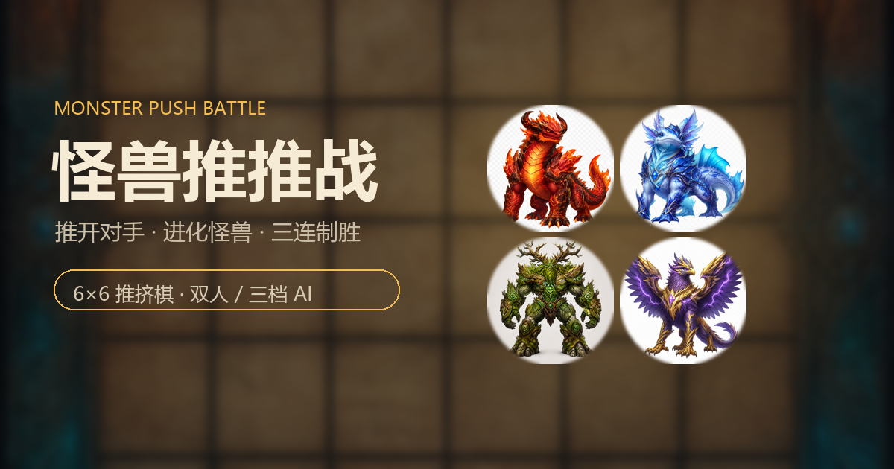

<div align="center">



# 怪兽推推战 · Monster Push Battle

**一款可以直接在浏览器里玩的双人推挤式三连棋**

落子会推开周围的棋子，幼年体三连进化为成年体，三只成年体连成一线即获胜。



[▶ 在线试玩](https://YOUR-USERNAME.github.io/monster-push-battle/)　·　[游戏规则](#游戏规则)　·　[本地运行](#本地运行)　·　[项目结构](#项目结构)

</div>

> 把上面的 `YOUR-USERNAME` 换成你的 GitHub 用户名，部署完成后链接即可使用。

---

## 玩法特色

| 机制 | 说明 |
|------|------|
| 🎲 **推挤落子** | 每落一子，会把周围八格中的棋子向外推一格；目标格被占用则推不动 |
| 🥚 **幼年体** | 幼年体只能推动幼年体；己方三枚幼年体连成直线时触发进化 |
| 🦖 **成年体** | 成年体可以推动任何棋子；三枚成年体连成一线即获胜 |
| 👑 **进化** | 一场中若只有一组三连则自动进化；出现多组时由玩家手动点选三枚 |
| ♻️ **回营** | 被推出棋盘的棋子会回到所属玩家的营地，可重新使用 |
| 🤝 **平局** | 棋盘填满或双方营地耗尽仍未分胜负，判为平局 |

### 游戏模式

- **双人对战**：同一台设备轮流落子
- **AI 对手**：三档难度，可选新手 / 进阶 / 高手

AI 采用「落子并结算推动之后」的局面评估，包含一步取胜、威胁堵截、双连构建、进化收益与推动收益等判断；高手档会进一步模拟对手的最佳回应。

### 其他功能

- 开局掷骰决定先手
- 双方各选一种怪兽，同一局不能重复选择
- 四种怪兽（熔岩兽 / 潮汐兽 / 森灵兽 / 雷翼兽），各有幼年体与成年体
- 落子、推动、进化、胜利均配有独立音效
- 可切换背景音乐，独立文件夹管理，支持自动识别
- 移动端自适应布局

## 游戏规则

1. 双方各有 8 枚幼年体、8 枚成年体，幼年体放在营地，成年体放在进化池。
2. 轮流从营地取一枚棋子放到 6×6 棋盘的 空格。
3. 落子后，新棋会把周围八格中符合规则的棋子向外推一格：
   - 幼年体只能推幼年体
   - 成年体可以推幼年体和成年体
   - 被推棋子的目标格若被占用，则该棋子不动
4. 己方三枚连续幼年体横、竖或斜排成一线时：
   - 若只有唯一一组：自动取走三枚并进化出一枚成年体
   - 若有多组：由当前玩家点选三枚后确认
   - 取走后，再结算本次落子的推动效果
5. 棋子被推出棋盘外时，回到所属玩家的营地。
6. 最先让三枚成年体连成直线的一方获胜。
7. 落子后即完成成年体三连时直接获胜，不再执行推动。

## 本地运行

游戏不使用任何框架，也不需要安装依赖，但**必须通过本地服务器打开**（浏览器会阻止通过 `file://` 加载音频与目录扫描）。

```bash
# 方式一：Python（推荐，零依赖）
python3 -m http.server 8080

# 方式二：Node.js
npx serve .
```

然后访问 <http://localhost:8080>。

## 部署到 GitHub Pages

### 方式一：网页上传（不需要命令行）

1. 在 GitHub 新建仓库，例如 `monster-push-battle`，选择 **Public**。
2. 点击 **uploading an existing file**，把本目录下所有文件与文件夹拖入（含 `.github`、`.nojekyll`）。
3. 提交后进入仓库 **Settings → Pages**。
4. **Source** 选择 **GitHub Actions**。
5. 回到 **Actions** 标签，等待 *Deploy to GitHub Pages* 运行完成。
6. 页面地址为：

```text
https://<你的用户名>.github.io/monster-push-battle/
```

### 方式二：命令行推送

```bash
git init
git add .
git commit -m "feat: 怪兽推推战 v1.0.0"
git branch -M main
git remote add origin https://github.com/<你的用户名>/monster-push-battle.git
git push -u origin main
```

推送后同样在 **Settings → Pages** 中选择 **GitHub Actions** 作为来源。

> 如果不想用 Actions，也可以在 Pages 里选择 **Deploy from a branch** → `main` → `/ (root)`。此时 `.nojekyll` 文件必须保留，否则以 `_` 开头的文件可能被忽略。

## 添加背景音乐

背景音乐放在独立目录中：

```text
assets/bgm/
```

支持 `.mp3`、`.wav`、`.ogg`、`.m4a`。添加文件后更新清单：

```bash
npm run build:bgm
```

该命令会扫描目录并重写 `js/audio-manifest.js`，游戏设置里的背景音乐列表即会显示**去掉扩展名的文件名**。

> GitHub Pages 不会返回目录文件列表，因此必须依赖这份清单。CI 会检查清单是否与目录一致，忘记更新会直接报错。

建议文件名尽量简短清晰，例如 `forest-night.mp3`、`领地低语.mp3`。

## 项目结构

```text
.
├── index.html                  # 入口页面（仅结构，不含逻辑）
├── css/
│   └── style.css               # 全部样式与响应式布局
├── js/
│   ├── board-core.js           # 纯棋盘内核：推动、进化、三连判定
│   ├── ai.js                   # AI 评估与搜索（三档难度）
│   ├── game.js                 # 游戏流程、回合、界面渲染
│   ├── effects.js              # 推动波纹、进化闪光、胜利彩带
│   └── audio-manifest.js       # 背景音乐清单（自动生成）
├── assets/
│   ├── bgm/                    # 背景音乐
│   ├── audio/                  # 音效
│   └── images/                 # 棋盘与怪兽棋子
├── scripts/
│   └── build-bgm-manifest.js   # 扫描背景音乐目录
├── .github/workflows/
│   ├── pages.yml               # 自动部署到 GitHub Pages
│   └── verify.yml              # 语法、清单与资源检查
├── .nojekyll                   # 关闭 Jekyll 处理
└── LICENSE                     # MIT
```

## 常见问题

**页面打开是空白或没有声音？**
请通过本地服务器或 GitHub Pages 访问，不要直接双击 `index.html`。

**背景音乐列表为空？**
检查 `assets/bgm/` 是否有音频文件，并运行 `npm run build:bgm` 重新生成清单。

**AI 想得太久？**
高手档每步约 0.2–0.6 秒；如果需要更快，可在设置中选择进阶或新手。

## 贡献

欢迎提交 Issue 与 Pull Request。开始前请阅读 [CONTRIBUTING.md](CONTRIBUTING.md)。

## 许可

代码以 [MIT License](LICENSE) 开源。

怪兽棋子与棋盘插画为本项目生成的原创素材，随项目一同以 MIT 协议提供；如需商用请自行确认素材合规性。
